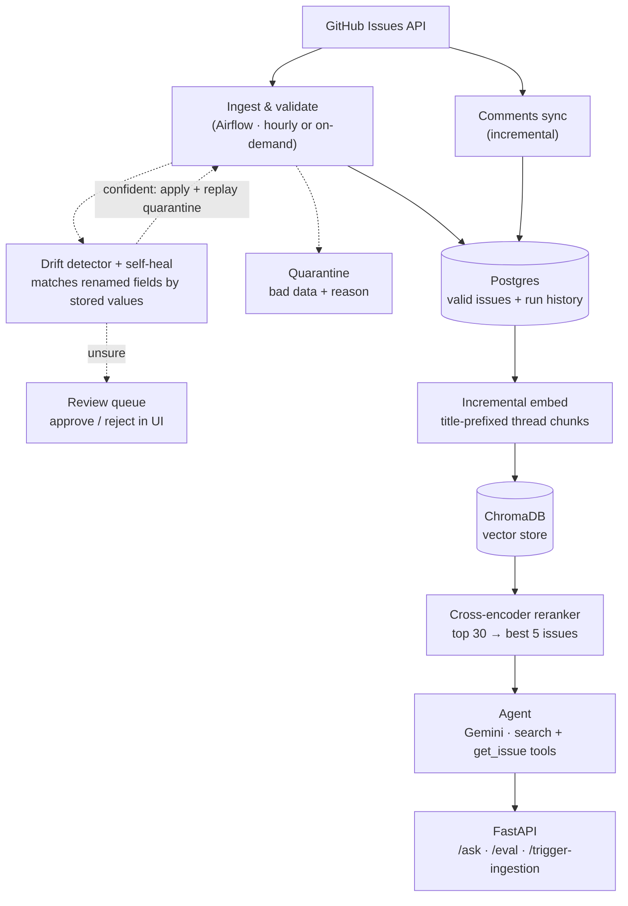

<div align="center">


# Agent-Ready RAG Pipeline with Self-Healing Schema Drift Detection


*RAG systems go stale — and go silently wrong — when the source data underneath them changes shape. This pipeline keeps a LangGraph agent's knowledge base fresh, catches that kind of drift before it corrupts an answer, and proves it live instead of just claiming it.*

[**Why this exists**](#why-this-exists) •
[**Architecture**](#architecture) •
[**Capabilities**](#capabilities) •
[**Screenshots**](#screenshots) •
[**Running it locally**](#running-it-locally) •
[**Deployment**](#deployment) •
[**Testing**](#testing) •
[**Honest limitations**](#honest-limitations)

<br />

---


</div>

---

## Why this exists

Most RAG demos assume the source data never changes shape. Real ones don't get that luxury — an upstream API renames a field, a vendor restructures a payload, and the agent keeps answering fluently while quietly working off corrupted context. Nobody notices until the answers get worse and someone has to go find out why.

This project ingests GitHub issues on a schedule, and specifically watches for that failure mode: it fingerprints the *structure* of incoming data every run, diffs it against the previous run, and when a field disappears or gets renamed, it doesn't just alert — it tries to **fix it automatically**, with a measured confidence threshold, and defers to a human when it isn't confident enough to guess. The whole pipeline (ingestion, validation, incremental embedding, the agent, and evaluation) is built around that one real problem, not bolted onto a generic RAG tutorial.

## Architecture



Ingestion counts, drift alerts, and every eval run (retrieval Hit@5/MRR and answer faithfulness/relevance, each tied to the exact question-set version) are tracked in MLflow, and the whole stack is containerized with Docker Compose.

## Results

Retrieval measured on a human-reviewed golden question set (each question tied to the issue that answers it), logged in MLflow:

| Setup | Hit@5 | MRR |
|---|---|---|
| Whole issue (title + body), vectors only | 0.783 | 0.667 |
| + cross-encoder reranker | 0.835 | 0.722 |
| Comment-thread chunks, vectors only | 0.835 | 0.744 |
| **Comment-thread chunks + reranker** | **0.896** | **0.782** |

Measured on 212 questions; re-checked on an expanded 304-question set: chunks 0.826 → chunks + reranker **0.895** (MRR 0.775). Chunking and reranking each add ~5 points of Hit@5 on their own.

## Capabilities

- **Scheduled + on-demand ingestion** — an Airflow DAG refreshes every tracked repo hourly, incrementally (a per-repo cursor, so only records changed since that repo's last run), and can also be triggered on-demand from the UI for *any* public repo via Airflow's REST API. Repo names are validated against GitHub's naming rules before they get anywhere near a shell.
- **Real validation, not a happy-path parser** — Pydantic schema checks catch malformed records (blank titles, invalid state values, missing required fields) and route them to a `quarantine` table with the actual reason, instead of crashing the run or silently dropping data.
- **Incremental embedding** — a content hash decides whether a record actually changed; unchanged issues never get re-embedded, avoiding the classic "re-embed everything every run" cost blowup.
- **Schema drift detection + self-healing by evidence** — fingerprints field presence/type every run (ignoring batches under 20 records, with the GitHub API version pinned). When a field disappears, it finds the new key that holds the *exact values already stored* for the same issues (e.g. `body` gone, `description` matches 38/40 known issues). ≥90% evidence is auto-applied and quarantined records are replayed; weaker evidence goes to a review queue with approve/reject in the UI; no evidence means no guess.
- **Comments + chunking** — comment threads are synced incrementally from GitHub's repo-wide comments endpoint, cleaned (issue-template boilerplate and bot comments removed), and split into ~150-word chunks that each start with the issue title. Search ranks chunks, then returns the best chunk per issue.
- **Reranking** — vector search fetches the top 30 chunks; a cross-encoder (`ms-marco-MiniLM-L-6-v2`) re-reads each with the question and picks the best 5 issues.
- **A genuine tool-calling agent** — built on LangChain/LangGraph's current agent API, with a search tool and a `get_issue` tool that opens an issue's full thread; repo-scoped so it can never accidentally search the wrong repo's data, with a live streamed reasoning trace instead of a blind spinner.
- **Honest about not knowing** — the agent is explicitly instructed to say so when a search doesn't turn up anything relevant, instead of inventing a plausible-sounding answer.
- **Bounded, not hanging, failures** — a hard timeout (enforced independently of the LLM SDK's own unreliable retry settings) means a slow or overloaded upstream model fails cleanly within a bounded time instead of hanging indefinitely — a real bug found and fixed during development, not a hypothetical.
- **A real RAG eval, not just a demo** — each repo gets a *golden question set*: questions drafted from closed issues, where the source issue is the known right answer, then human-reviewed. Retrieval is scored objectively (Hit@5: did the right issue make the top 5? MRR: how high?) with no LLM calls, daily. The answer eval runs the real agent and has an LLM judge score faithfulness and answer relevance; judge failures are counted, never silently scored as 0.
- **Cost-aware by design** — capped tool-call loops, batched judge calls, and an in-process response cache for repeat questions.

## Screenshots

**Ask the agent — honest about what it doesn't know.** Asked about UI issues in a repo with none embedded, it reports that plainly instead of inventing a plausible-sounding answer, citing exactly what it searched for along the way.


**Drift detection + self-healing, proven live.** Not a canned example — this runs the real detector, healer, and extraction code against a randomized drift scenario every time, across 20 records. A plain rename (`state` → `status`) is healed because 20/20 known records carry identical values; a field that was renamed *and* reformatted has no evidence and is correctly left for human review, not guessed. *(Screenshot predates the switch from name matching to value evidence.)* One record also carries an unrelated, independent data issue — flagged separately from the schema drift, showing the two failure modes aren't conflated.


**Triggering ingestion for a new repo, live.** The repo field at the top of the UI drives everything below it — point it at any public repo and the real Airflow DAG queues and runs, with status polled live.


## Running it locally

```bash
git clone https://github.com/YOUR_USERNAME/rag-drift-pipeline.git
cd rag-drift-pipeline
cp .env.example .env   # fill in GEMINI_API_KEY, GITHUB_TOKEN, AIRFLOW_API_PASSWORD
docker compose up -d --build
```

This starts Postgres, a Chroma vector server, Airflow (`localhost:8080`), and the FastAPI + UI (`localhost:8000`). The pipeline's database schema is applied by alembic migrations on every boot (`airflow-init` runs `python -m pipeline.migrate upgrade head`; already-applied revisions are skipped). First build takes a few minutes (installing `torch`/`sentence-transformers`). Airflow's browser login uses a randomly-generated password on first boot:

```bash
docker logs rag_airflow | grep -i password
```

Trigger ingestion for a repo from the UI's top bar, then use the Ask / Drift & self-heal / Evaluation tabs.

## Deployment

Containerized as four services (Postgres, Chroma server, Airflow, FastAPI) with Docker Compose; runs locally or on any VM with Docker installed.

## Database migrations

The schema lives in `pipeline/migrations` (alembic), not a one-shot `init.sql`:

```bash
python -m pipeline.migrate upgrade head          # apply
python -m pipeline.migrate current               # what's applied
python -m pipeline.migrate upgrade head --sql    # print the SQL instead of running it
python -m pipeline.migrate revision -m "add x"   # new revision
```

Migrations use their own version table (`rag_alembic_version`) because Airflow keeps its metadata -- and its own `alembic_version` table -- in the same database. Existing deployments created by the old `init.sql` adopt migrations with a plain `upgrade head`: the baseline revision is `IF NOT EXISTS` throughout.

## Evaluation

```bash
# 1. Draft a golden question set from a repo's closed, discussed issues (needs GEMINI_API_KEY + ingested data)
python -m pipeline.golden_set generate --repo langchain-ai/langchain --n 40
# 2. Review pipeline/golden/langchain-ai__langchain.jsonl: fix or delete weak questions, set "reviewed": true
# 3. Score retrieval (no LLM calls) and log it to MLflow
python -m pipeline.mlflow_tracking --eval-only --repo langchain-ai/langchain
```

The daily `rag_pipeline_eval` DAG repeats step 3 for every repo that has a golden set; the UI's Evaluation tab runs the answer eval. Commit the golden files: they're the fixed yardstick every retrieval change is measured against.

## Testing

```bash
pip install torch --index-url https://download.pytorch.org/whl/cpu
pip install -r requirements-dev.txt
docker compose up -d postgres
python -m pipeline.migrate upgrade head
pytest -v
```

Unit tests cover schema validation, drift detection, self-heal matching, repo-name validation (incl. shell-injection payloads), Chroma/model caching, and agent source attribution -- including an end-to-end run of the real LangChain agent loop with a scripted model. Integration tests run the actual ingestion pipeline against a live Postgres: quarantine of malformed and unexpected records, per-repo cursor isolation, and the multi-repo refresh. They auto-skip without a database; GitHub Actions runs everything against a real Postgres service on every push.

## Honest limitations

Said plainly, not hidden:

- **Self-healing needs overlap** -- it verifies a rename using issues already stored, so it needs at least 5 known issues in the drifted batch; a field that is renamed *and* reformatted (e.g. lowercase -> uppercase) has no evidence and always goes to human review.
- **Golden questions are LLM-drafted from their source issue** (then human-reviewed), so absolute scores are somewhat optimistic; the before/after comparisons use the same set and are the meaningful part.
- **The response cache is in-process and exact-match** -- no cross-instance sharing, no semantic matching of near-duplicate questions. A production deployment would want Redis and semantic caching.
- **No provider fallback** -- if Gemini is down, the request fails cleanly (a real improvement over hanging), but there's no automatic failover to a second LLM provider.
- **LLM-as-judge evaluation has known weaknesses** -- it's directionally useful for catching regressions over time, not a substitute for human eval, and shares blind spots with the model it's judging.
- **No hybrid (BM25) search** -- with the reranker already at Hit@5 ≈ 0.90, a second keyword index wasn't worth keeping in sync.
- **Hard-coded local credentials in docker-compose and no API auth** -- fine for a local demo, not for a public deployment.