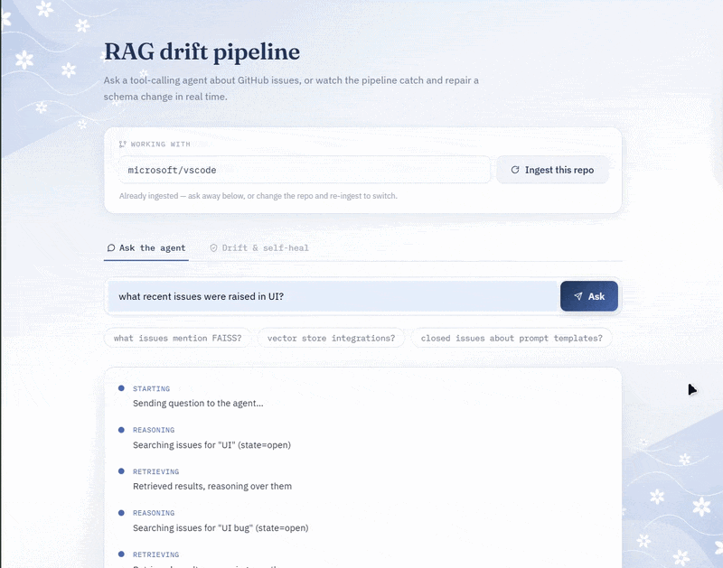
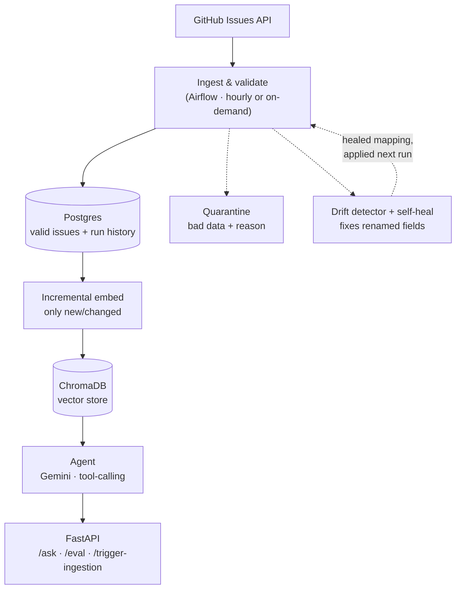
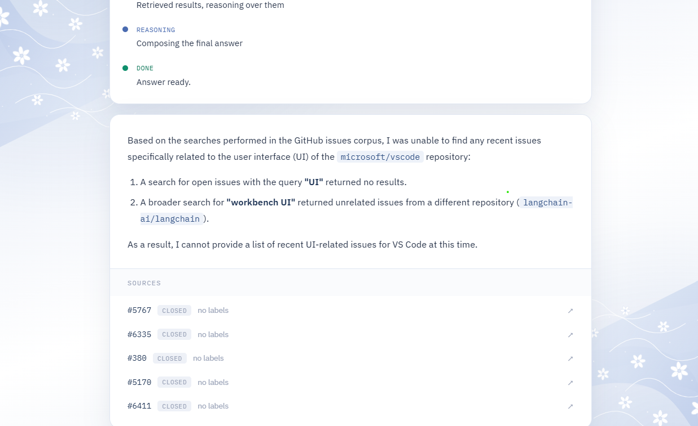
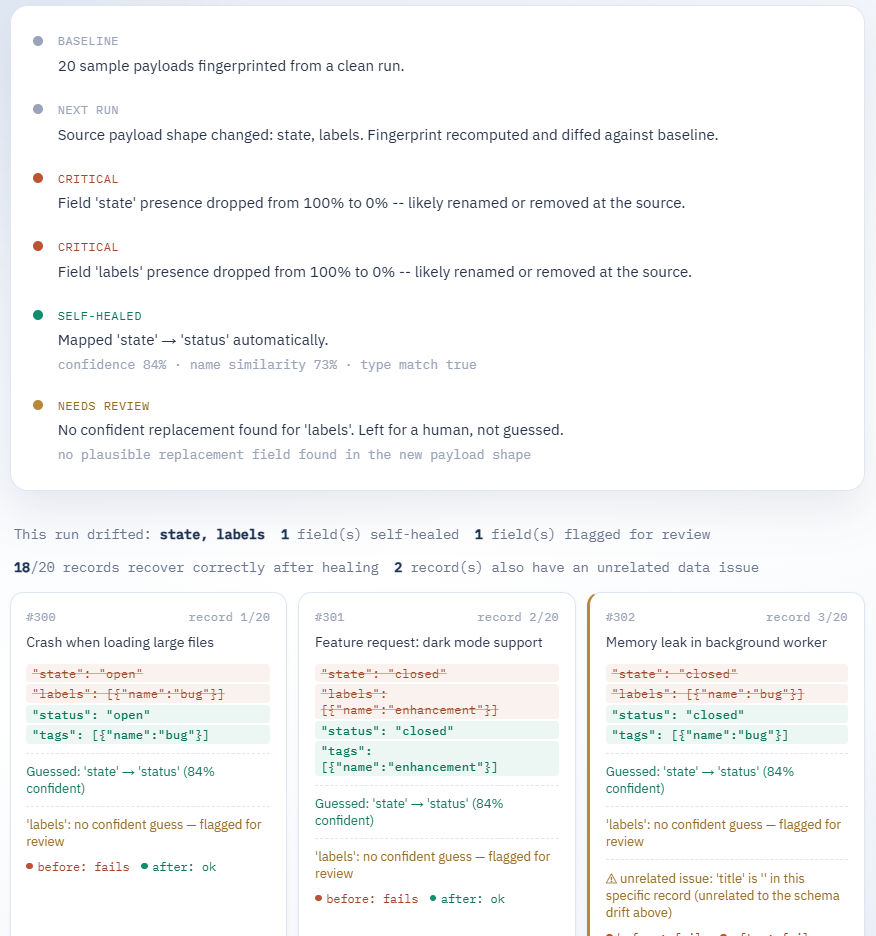
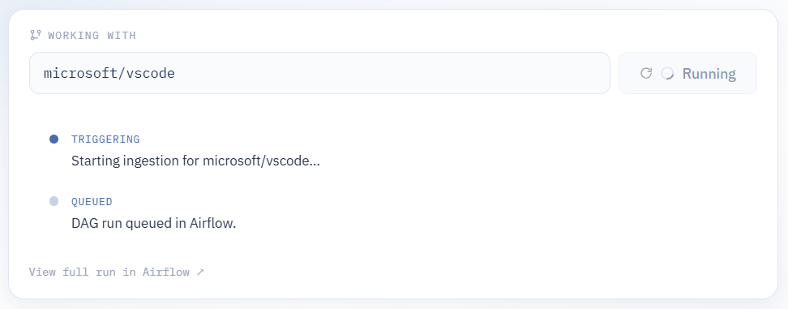
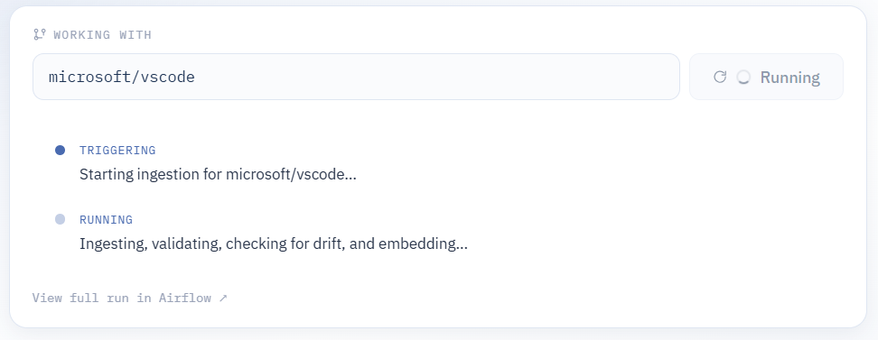

<div align="center">


# Agent-Ready RAG Pipeline with Self-Healing Schema Drift Detection


*RAG systems go stale — and go silently wrong — when the source data underneath them changes shape. This pipeline keeps a LangGraph agent's knowledge base fresh, catches that kind of drift before it corrupts an answer, and proves it live instead of just claiming it.*

[**Why this exists**](#why-this-exists) •
[**Architecture**](#architecture) •
[**Capabilities**](#capabilities) •
[**Screenshots**](#screenshots) •
[**Running it locally**](#running-it-locally) •
[**Deployment**](#deployment) •
[**Testing**](#testing) •
[**Honest limitations**](#honest-limitations)

<br />

---



</div>

---

## Why this exists

Most RAG demos assume the source data never changes shape. Real ones don't get that luxury — an upstream API renames a field, a vendor restructures a payload, and the agent keeps answering fluently while quietly working off corrupted context. Nobody notices until the answers get worse and someone has to go find out why.

This project ingests GitHub issues on a schedule, and specifically watches for that failure mode: it fingerprints the *structure* of incoming data every run, diffs it against the previous run, and when a field disappears or gets renamed, it doesn't just alert — it tries to **fix it automatically**, with a measured confidence threshold, and defers to a human when it isn't confident enough to guess. The whole pipeline (ingestion, validation, incremental embedding, the agent, and evaluation) is built around that one real problem, not bolted onto a generic RAG tutorial.

## Architecture



Ingestion counts, drift alerts and the daily retrieval-eval score are tracked in MLflow (the on-demand full eval -- faithfulness and answer relevance -- is streamed to the UI but not yet logged to MLflow), and the whole stack is containerized with Docker Compose.

## Capabilities

- **Scheduled + on-demand ingestion** — an Airflow DAG refreshes every tracked repo hourly, incrementally (a per-repo cursor, so only records changed since that repo's last run), and can also be triggered on-demand from the UI for *any* public repo via Airflow's REST API. Repo names are validated against GitHub's naming rules before they get anywhere near a shell.
- **Real validation, not a happy-path parser** — Pydantic schema checks catch malformed records (blank titles, invalid state values, missing required fields) and route them to a `quarantine` table with the actual reason, instead of crashing the run or silently dropping data.
- **Incremental embedding** — a content hash decides whether a record actually changed; unchanged issues never get re-embedded, avoiding the classic "re-embed everything every run" cost blowup.
- **Schema drift detection + self-healing** — fingerprints field presence/type every run; when a field disappears, fuzzy-matches it against the new payload shape and either auto-applies a high-confidence mapping (verified against the pipeline's *real* validation code, not simulated) or flags it for human review rather than guessing.
- **A genuine tool-calling agent** — built on LangChain/LangGraph's current agent API, repo-scoped so it can never accidentally search the wrong repo's data, with a live streamed reasoning trace instead of a blind spinner.
- **Honest about not knowing** — the agent is explicitly instructed to say so when a search doesn't turn up anything relevant, instead of inventing a plausible-sounding answer.
- **Bounded, not hanging, failures** — a hard timeout (enforced independently of the LLM SDK's own unreliable retry settings) means a slow or overloaded upstream model fails cleanly within a bounded time instead of hanging indefinitely — a real bug found and fixed during development, not a hypothetical.
- **A real RAG eval, not just a demo** — LLM-as-judge scoring across three separate RAGAS-style dimensions (retrieval relevance, faithfulness, answer relevance), streamed live, with rate-limit-aware pacing so it doesn't blow through a free-tier quota in one run.
- **Cost-aware by design** — capped tool-call loops, batched judge calls, and an in-process response cache for repeat questions.

## Screenshots

**Ask the agent — honest about what it doesn't know.** Asked about UI issues in a repo with none embedded, it reports that plainly instead of inventing a plausible-sounding answer, citing exactly what it searched for along the way.



**Drift detection + self-healing, proven live.** Not a canned example — this runs the real detector, healer, and extraction code against a randomized drift scenario every time, across 20 records. `state` gets auto-mapped to `status` at 84% confidence; `labels` has no confident match and is correctly left for human review, not guessed. One record also carries an unrelated, independent data issue — flagged separately from the schema drift, showing the two failure modes aren't conflated.



**Triggering ingestion for a new repo, live.** The repo field at the top of the UI drives everything below it — point it at any public repo and the real Airflow DAG queues and runs, with status polled live.




## Running it locally

```bash
git clone https://github.com/YOUR_USERNAME/rag-drift-pipeline.git
cd rag-drift-pipeline
cp .env.example .env   # fill in GEMINI_API_KEY, GITHUB_TOKEN, AIRFLOW_API_PASSWORD
docker compose up -d --build
```

This starts Postgres, a Chroma vector server, Airflow (`localhost:8080`), and the FastAPI + UI (`localhost:8000`). The pipeline's database schema is applied by alembic migrations on every boot (`airflow-init` runs `python -m pipeline.migrate upgrade head`; already-applied revisions are skipped). First build takes a few minutes (installing `torch`/`sentence-transformers`). Airflow's browser login uses a randomly-generated password on first boot:

```bash
docker logs rag_airflow | grep -i password
```

Trigger ingestion for a repo from the UI's top bar, then use the Ask / Drift & self-heal / Evaluation tabs.

## Deployment

Containerized as four services (Postgres, Chroma server, Airflow, FastAPI) and deployed to an Azure VM. The VM is started on-demand around active demos/interviews rather than left running 24/7 -- a deliberate cost decision for a portfolio project, not a limitation of the stack itself; the same Compose file runs identically on any VM with Docker installed.

## Database migrations

The schema lives in `pipeline/migrations` (alembic), not a one-shot `init.sql`:

```bash
python -m pipeline.migrate upgrade head          # apply
python -m pipeline.migrate current               # what's applied
python -m pipeline.migrate upgrade head --sql    # print the SQL instead of running it
python -m pipeline.migrate revision -m "add x"   # new revision
```

Migrations use their own version table (`rag_alembic_version`) because Airflow keeps its metadata -- and its own `alembic_version` table -- in the same database. Existing deployments created by the old `init.sql` adopt migrations with a plain `upgrade head`: the baseline revision is `IF NOT EXISTS` throughout.

## Testing

```bash
pip install torch --index-url https://download.pytorch.org/whl/cpu
pip install -r requirements-dev.txt
docker compose up -d postgres
python -m pipeline.migrate upgrade head
pytest -v
```

Unit tests cover schema validation, drift detection, self-heal matching, repo-name validation (incl. shell-injection payloads), Chroma/model caching, and agent source attribution -- including an end-to-end run of the real LangChain agent loop with a scripted model. Integration tests run the actual ingestion pipeline against a live Postgres: quarantine of malformed and unexpected records, per-repo cursor isolation, and the multi-repo refresh. They auto-skip without a database; GitHub Actions runs everything against a real Postgres service on every push.

## Honest limitations

Said plainly, not hidden:

- **Self-healing is name-similarity based**, not semantic -- it catches renames that keep recognizable characters (`state` -> `status`), not arbitrary synonyms.
- **The response cache is in-process and exact-match** -- no cross-instance sharing, no semantic matching of near-duplicate questions. A production deployment would want Redis and semantic caching.
- **No provider fallback** -- if Gemini is down, the request fails cleanly (a real improvement over hanging), but there's no automatic failover to a second LLM provider.
- **LLM-as-judge evaluation has known weaknesses** -- it's directionally useful for catching regressions over time, not a substitute for human eval, and shares blind spots with the model it's judging.
- **No chunking** -- issues are embedded as whole documents (title + body), which works because they're short and self-contained; a source with long documents (wikis, PDFs) would need a real chunking strategy this project hasn't had to solve.
- **Comments/discussions aren't ingested**, only issue metadata -- the natural next step for making retrieval genuinely more useful (surfacing actual fixes people posted, not just issue titles), deliberately scoped out given the added chunking and per-issue API-cost complexity it would introduce.